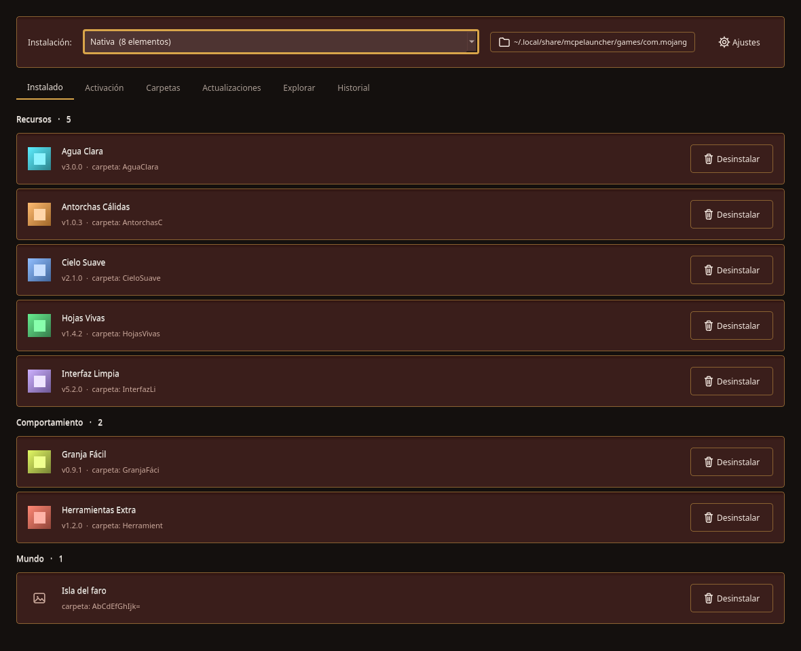
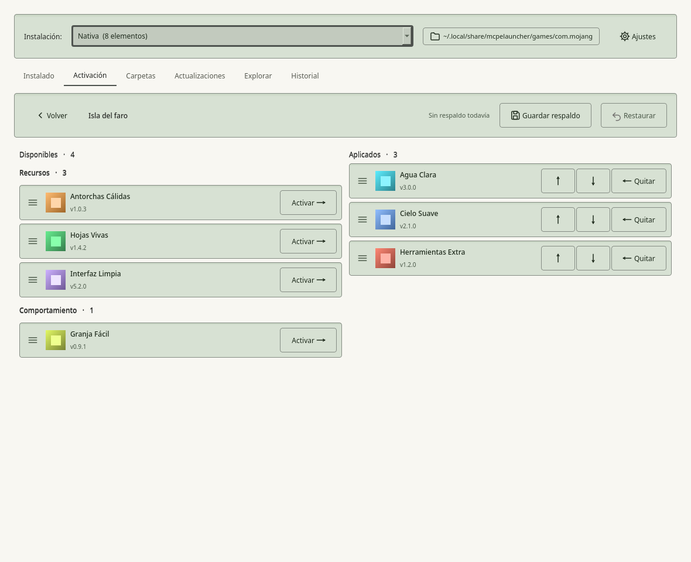
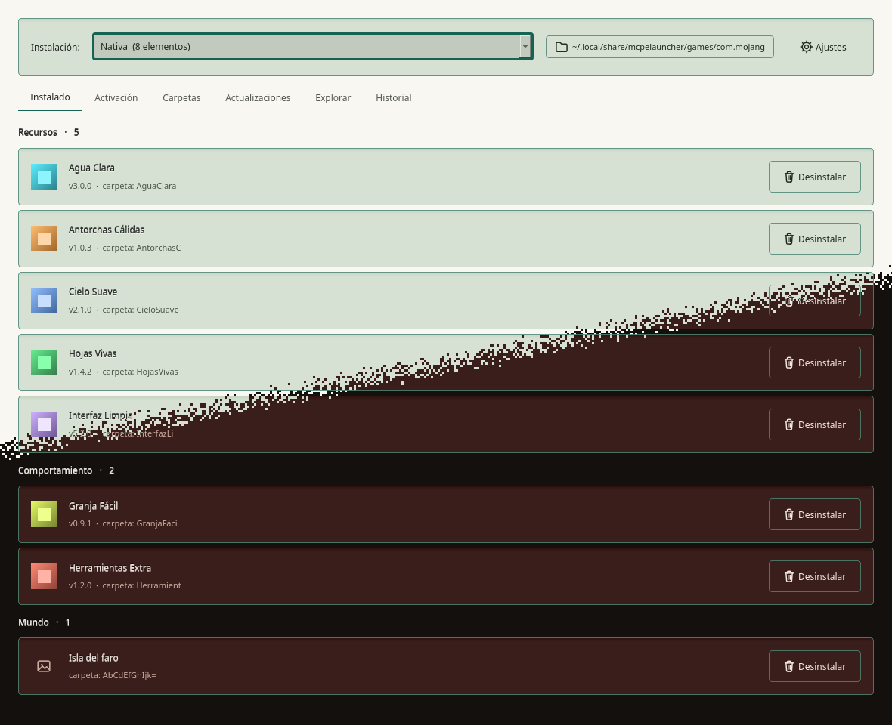

<div align="center">

# MCPEModManager

**Gestor de packs, addons y mundos de Minecraft Bedrock para Linux.**


</div>

---

## Qué es

MCPEModManager ordena el contenido de Minecraft Bedrock que se juega en Linux con
[mcpelauncher](https://mcpelauncher.readthedocs.io/): resource packs, behavior packs,
addons, skins, plantillas y mundos, dentro de la carpeta `com.mojang` del juego.

Reconoce cada archivo por lo que lleva dentro y no por su extensión, sabe qué pack es
cada uno aunque su autor le cambie el identificador entre versiones, y deja activar
packs en el juego —para todo el juego o para un mundo concreto— sin abrir un JSON a
mano. Antes de tocar un mundo, lo respalda.

<p align="center">
  
  &nbsp;
  
  &nbsp;
  
</p>

<p align="center"><sub>Instalación y packs de demostración. Las capturas se regeneran con <code>tools/capturas/capturas.py</code>.</sub></p>

## Funciones principales

- **Instalado**: todo lo que hay en el juego, por clase de contenido, con versión, forma
  de instalación y botón para desinstalar o extraer.
- **Instalar arrastrando**: `.mcpack`, `.mcaddon`, `.mcworld`, `.mctemplate` o `.zip`,
  decidido por su `manifest.json`. Un pack más nuevo sustituye al anterior.
- **Activación**: dos columnas, disponibles y aplicados, para el ámbito global y para
  cada mundo, con el orden que decide qué pack gana. Respeta la variante (*subpack*)
  elegida.
- **Respaldo de mundos**: obligatorio antes de cambiar sus packs, y restaurable.
- **Carpetas vigiladas**: las descargas y las carpetas que se añadan, con lo nuevo marcado.
- **Actualizaciones y Explorar**: empareja lo instalado con los catálogos de MCPEDL y
  CurseForge (con la clave de API de cada usuario) y avisa de versiones nuevas.
- **Varias instalaciones**: la nativa y las flatpak de mcpelauncher, cada una con su
  `com.mojang`.
- **Historial** de lo instalado, actualizado y desinstalado.

## Tecnologías

| Capa | Tecnología |
|---|---|
| Interfaz | PySide6 (Qt 6) con [Wulfenite UI](https://github.com/noctivulp-ch/wulfenite_ui) (`wulf_qt`) |
| Datos | SQLite, sin ORM |
| Formatos | lectura de `manifest.json` y de paquetes zip anidados, también remotos por rangos HTTP |
| Binario | Nuitka *onefile* |
| Pruebas | pytest, con instalaciones falsas en temporales; arranque real de la UI sin pantalla |

## Requisitos

- Linux con Python 3.12 o superior.
- [mcpelauncher](https://mcpelauncher.readthedocs.io/) con al menos una versión de
  Minecraft Bedrock instalada: el gestor trabaja sobre su carpeta `com.mojang`.

## Puesta en marcha

```bash
python -m venv .venv
.venv/bin/pip install -e ".[dev]"   # instala también wulf_qt desde GitHub
.venv/bin/mcpemod
```

Para comprobar el entorno sin abrir la ventana:

```bash
.venv/bin/mcpemod --diagnostico
QT_QPA_PLATFORM=offscreen .venv/bin/python -m pytest -q
```

El tema por defecto es oscuro con oro; otro se elige con `MCPEMOD_TEMA=claro-peltre`
(ver [`docs/funciones/tema.md`](docs/funciones/tema.md)). `check.sh` y `build.sh`
(fish) verifican y compilan el binario con Nuitka.

## Documentación

La arquitectura, las funciones y las decisiones (ADR) están en [`docs/`](docs/index.md).
Las dos reglas del dominio —qué es un archivo lo dice su contenido, y qué pack es lo
dice su nombre mientras su versión decide el reemplazo— se explican en la
[ADR 0020](docs/decisiones/0020-nombre-identifica-uuid-versiona.md).

MCPEModManager no está afiliado a Mojang ni a Microsoft. Minecraft es una marca de
Mojang Synergies AB.

## Licencia

Código bajo **GPL-3.0-or-later** ([`LICENSE`](LICENSE)). Los componentes de terceros y sus licencias
están en [`NOTICE`](NOTICE). El nombre y la identidad visual no forman parte de la licencia: ver
[`TRADEMARKS.md`](TRADEMARKS.md). Para aportar, [`CONTRIBUTING.md`](CONTRIBUTING.md).

## Apoyo

Este proyecto forma parte del trabajo de **NoctiVulp**: herramientas para Linux y Android,
publicadas como software libre. Las compilaciones oficiales y las novedades salen en Patreon.

<p align="center">
  <a href="https://www.patreon.com/cw/NoctiVulp"></a>
</p>

---

<p align="center"><sub>© 2026 NoctiVulp · <b>Powered by AI</b> — desarrollado con la asistencia de Claude, de Anthropic.</sub></p>
